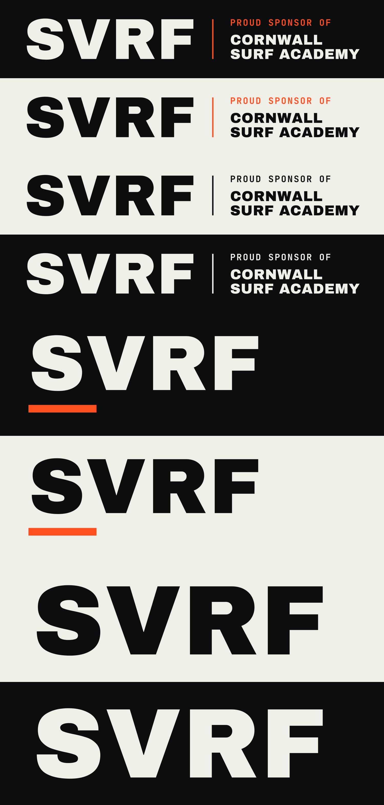
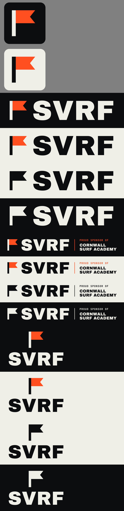

# SVRF logo pack: Cornwall Surf Academy sponsorship

Print-ready SVRF logos for the academy's sponsor boards, kit, banners, website and social posts.
All text is converted to vector outlines, so no fonts are needed to open or print the files.

There are two sets:

- **No flag:** the SVRF wordmark as it already appears on the website and app. Use this
  wherever you want the logo people already know.
- **With flag:** the newer flag mark next to the wordmark.





## Which file to send

| Need | Use |
| --- | --- |
| Printer, sign maker, embroidery, vinyl | `pdf/` or `svg/` (vector, scales to any size) |
| Website, social, documents | `png/` (transparent background) |
| Sponsor board or banner that names the academy (no flag) | `svrf-sponsor-lockup-no-flag-*` |
| Most other places (no flag) | `svrf-wordmark-*` |
| Sponsor board or banner that names the academy (with flag) | `svrf-sponsor-lockup-*` |
| Most other places (with flag) | `svrf-primary-*` (horizontal) |
| Square or narrow spaces (shirts, rash vests, boards; with flag) | `svrf-stacked-*` |
| Profile pictures, favicons, stickers (with flag) | `svrf-icon-*` |

## Colourways

- **full-colour-dark-bg**: Chalk wordmark, Flag Orange flag. Use on dark or photo backgrounds.
- **full-colour-light-bg**: Ink wordmark, Flag Orange flag. Use on white or light backgrounds.
- **mono-black / mono-white**: one colour, for single-colour printing, embroidery, vinyl and etching.

In the no-flag wordmark, the full-colour versions carry the Flag Orange bar under the S from
the app icon. The mono versions are the plain wordmark, as in the website header.

PNGs are 6000 px on the long edge (icons are 4096 × 4096), which is 20 in / 50 cm wide at 300 dpi.
For anything bigger, such as banners or flags, use the PDF or SVG.

## Brand colours

| Name | HEX | RGB | CMYK (approx.) |
| --- | --- | --- | --- |
| Flag Orange | `#FF4E1F` | 255 78 31 | 0 74 90 0 |
| Ink | `#0B0D0E` | 11 13 14 | 70 60 60 90 |
| Chalk | `#EFEEE7` | 239 238 231 | 5 4 9 0 |

The CMYK values are a starting point. Ask the printer to match Flag Orange to a proof.

## Usage

- Keep clear space around the logo on every side at least the height of the flag, or of the
  letter S in the no-flag versions.
- Don't use the primary logo smaller than 25 mm wide in print or 120 px on screen.
  The sponsor lockup needs at least 60 mm or 300 px so the small text stays readable.
- Don't stretch, recolour, outline, add shadows or rearrange the parts.

## Regenerating

`brand/tools/gen.py` builds the SVGs from the Archivo Black and JetBrains Mono Bold fonts in
`node_modules/@fontsource`, and needs the Python packages `fonttools` and `uharfbuzz`. The site
uses the variable JetBrains Mono, so install the static one first with
`npm install --no-save @fontsource/jetbrains-mono`. `brand/tools/render.js` exports
the PNGs and PDFs with Playwright:

```bash
python3 brand/tools/gen.py <out-dir> && node brand/tools/render.js <out-dir>
```
